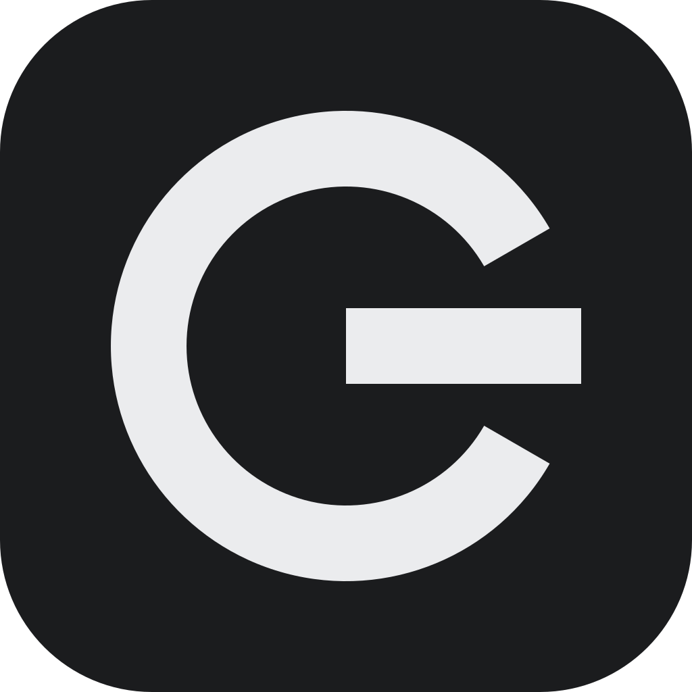

# G-System

G-System is my setup for running coding agents on servers I own. Claude Code and Codex sessions live and work on one central server, and that server manages the other hosts: a production host for deployed projects, a worker host for long jobs, and a Mac. The agents get the same tools on every host, and the system around them remembers what they learned and tells me when something breaks.

It has these parts:

- a topology source of truth, one manifest of hosts, services and projects
- environment wiring that gives every agent the same skills, settings and hooks
- a knowledge brain, a corpus of notes with an MCP server for agents and a REST API for the web
- a live data layer for what is true right now
- an alert spine that pushes to my phone and desktop through one ntfy topic
- a voice assistant on WhatsApp and the web
- a web dashboard and a desktop app
- a design language that every UI is built in
- a shared headful browser for pages that only a person is meant to use
- a starter template for new web apps

This repo is the front door. It holds no code, only this page, the [install guide](INSTALL.md), the diagrams and the screenshots. Each part lives in its own repo.

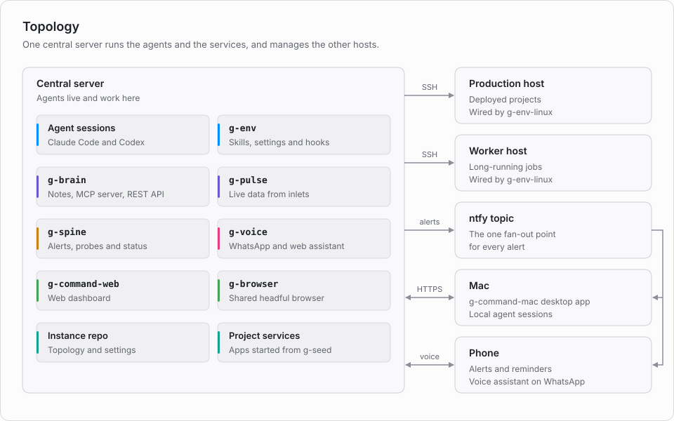

## Components

| Repo | What it is |
|---|---|
| [g-core](https://github.com/Volcanex/g-core) | Manifest schema, the renderer that turns a manifest into agent context, and an example instance |
| [g-env](https://github.com/Volcanex/g-env) | Shared agent environment: bootstrap, skills, hooks, Claude Code and Codex settings, and the instance resolver |
| [g-env-linux](https://github.com/Volcanex/g-env-linux) | Linux layer over g-env: shell, SSH config and a daily sync timer |
| [g-brain](https://github.com/Volcanex/g-brain) | Knowledge brain: the notes corpus, MCP server and REST API in one process, plus the packages below |
| [g-command-web](https://github.com/Volcanex/g-command-web) | Web dashboard for system health, the brain, the calendar, crons and compute |
| [g-command-mac](https://github.com/Volcanex/g-command-mac) | Desktop app: the dashboard in a native window, alert notifications and a menu-bar status panel |
| [g-design](https://github.com/Volcanex/g-design) | Design language: tokens, fonts, a framework-free component layer and a React layer |
| [g-browser](https://github.com/Volcanex/g-browser) | One always-on headful Chrome, run as a job service for agents |
| [g-seed](https://github.com/Volcanex/g-seed) | Starter template for G-System web apps, static-first on FastAPI |

g-brain holds four packages beside the corpus. They share a repo because they share one process and one vault.

| Package | What it does |
|---|---|
| g-spine | Probes every service, dedups alerts and writes the status snapshot |
| g-pulse | Keeps live state from inlets such as mail, feeds and webhooks |
| g-todos | Holds dated commitments and sends the reminders |
| g-voice | Runs the WhatsApp and web assistant |

Repos named `gp-` are my own projects built on it.

## Framework and instance

The `g-` repos are the framework. They hold code and defaults and nothing about any one owner. An instance repo holds one owner's real topology and settings: the manifest, the house rules agents read, override files for the environment, extra skills and the secrets passport. Mine is private. g-core ships an example instance to start from, built from documentation addresses and example.com.

g-env finds the instance in a fixed order and links its files into each home directory. An instance file replaces the framework's file whole, and nothing is merged. [INSTALL.md](INSTALL.md) has the order and the overlay table.

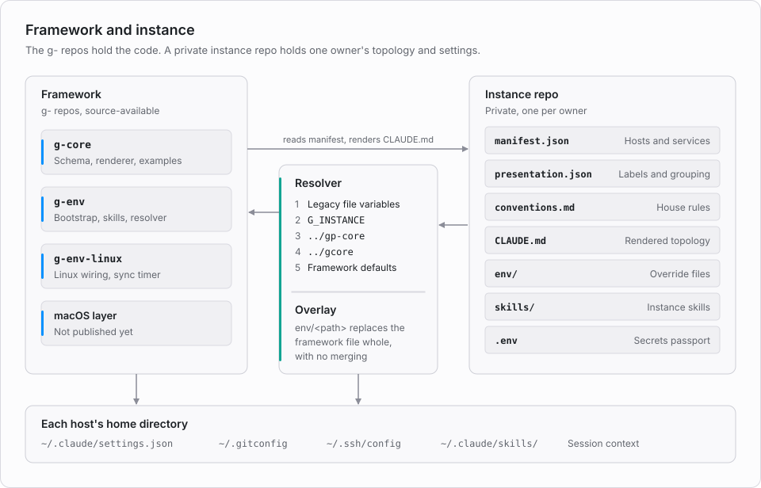

## How information moves

Each fact lands in one store, picked by its kind. A fact with a date goes to g-todos, a fact that is true now goes to g-pulse and a fact that is true always goes to the brain. Agents read all three through MCP and the dashboard reads them through the REST API. g-spine sends every alert through one ntfy topic, and my phone and the desktop app both subscribe to it.

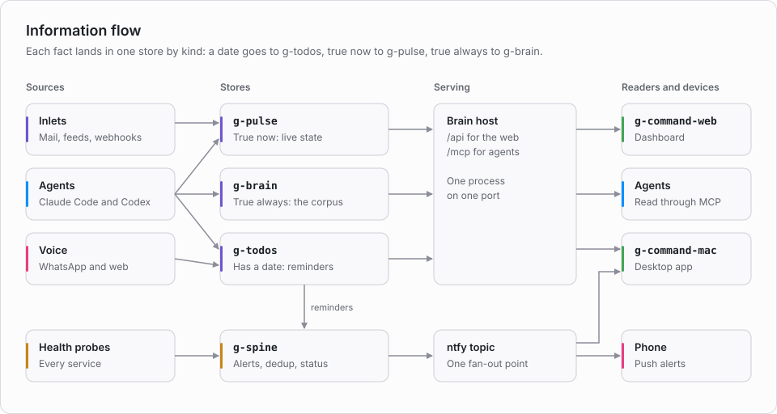

## Screenshots

I took these from a second copy of the dashboard reading live data, then replaced names, addresses, amounts and note titles with placeholders. A blurred value is private. The states are real, so a service shown down was down.

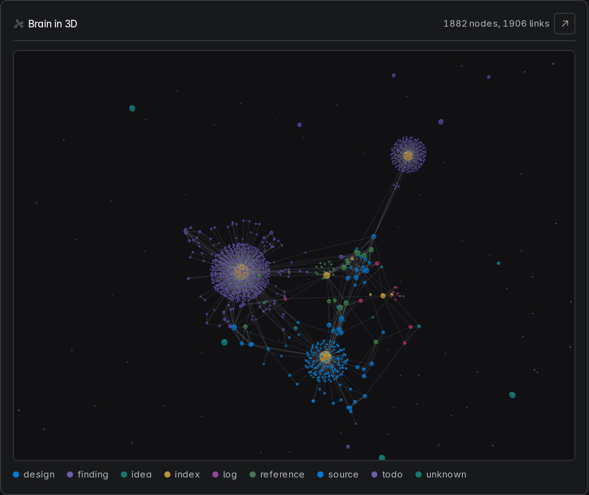
The brain in 3D. Each point is a note, coloured by kind, and the clusters form around the index notes that link them.

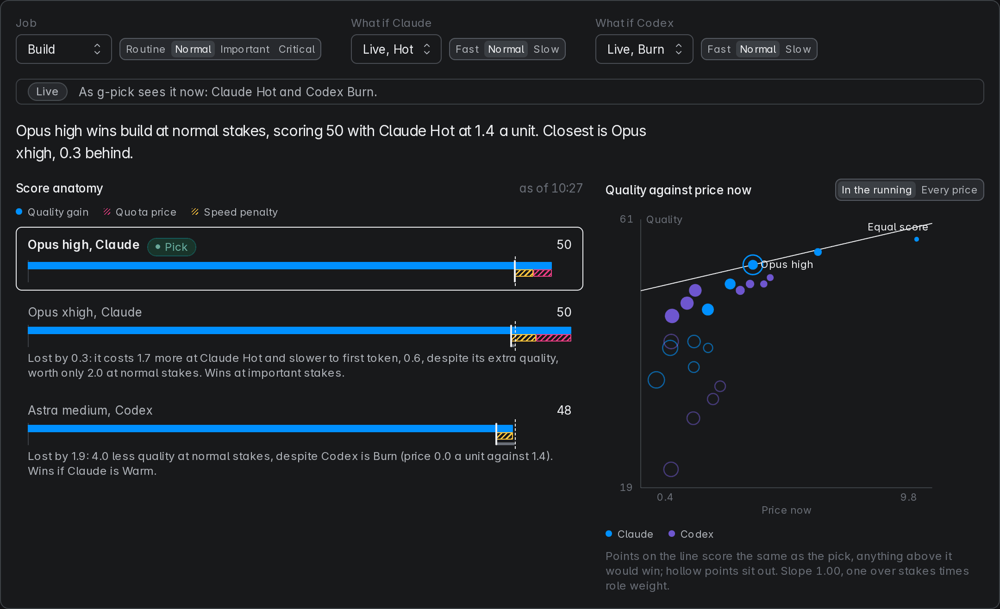
How g-pick chooses a model for a job. Each bar adds up quality, quota price and speed for one model at one effort. On the chart, any agent above the line would beat the pick.

| | |
|---|---|
| 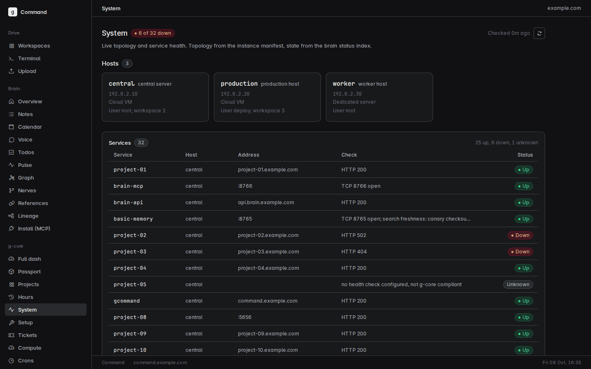 System health, dark | 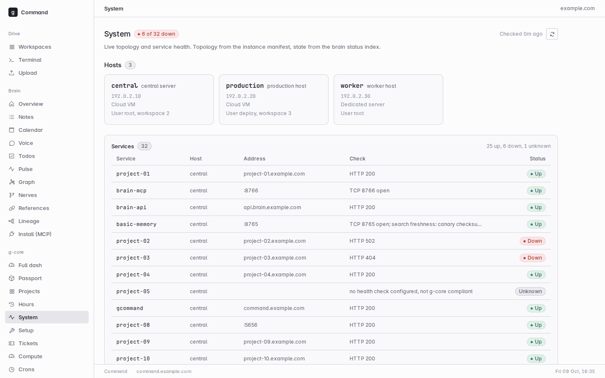 System health, light |
| 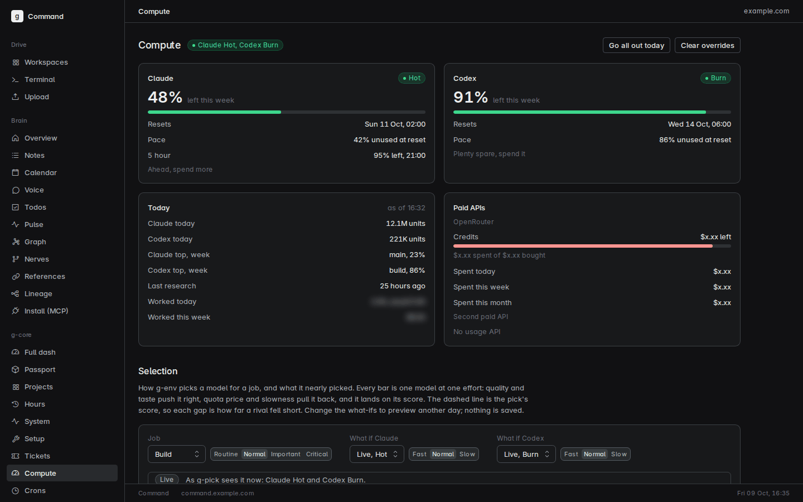 Agent quota and model selection | 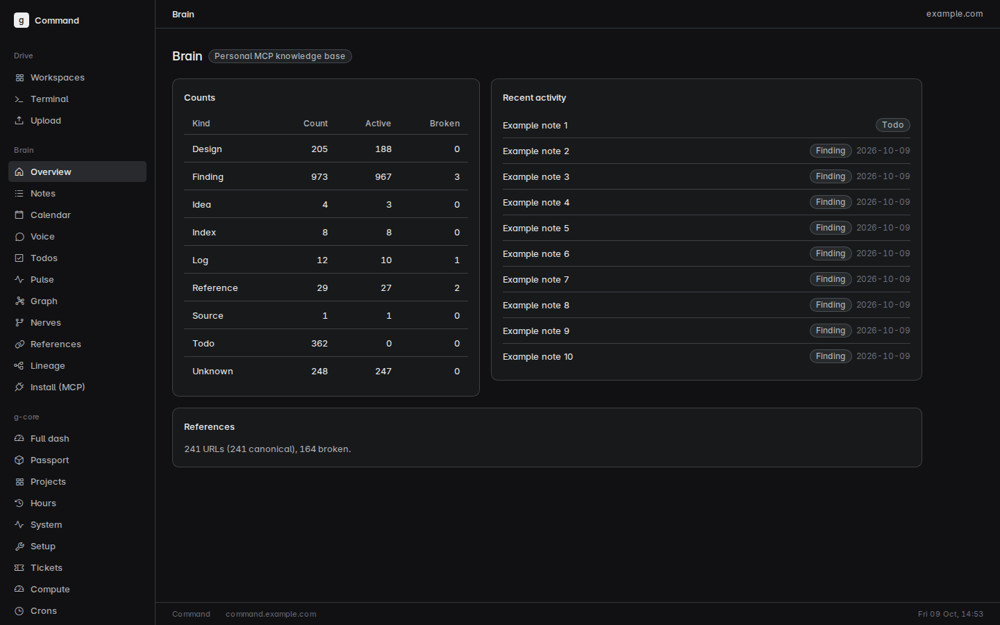 Brain overview |
| 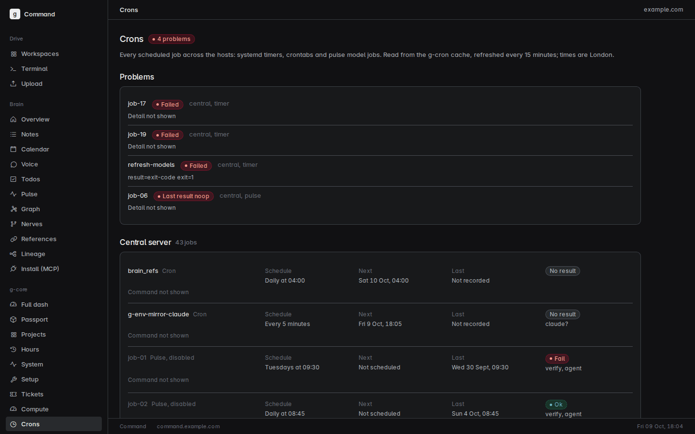 Every scheduled job across the hosts | 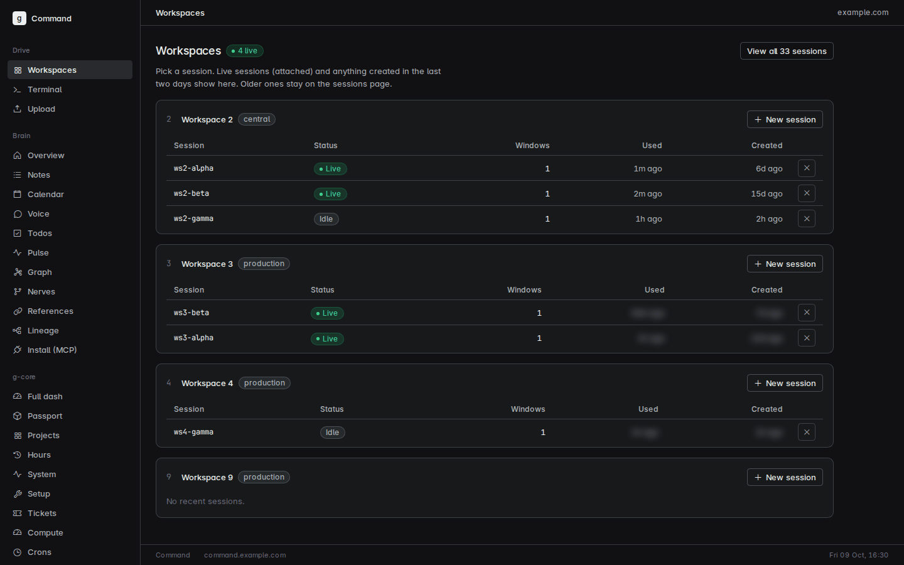 Agent sessions by workspace |
| 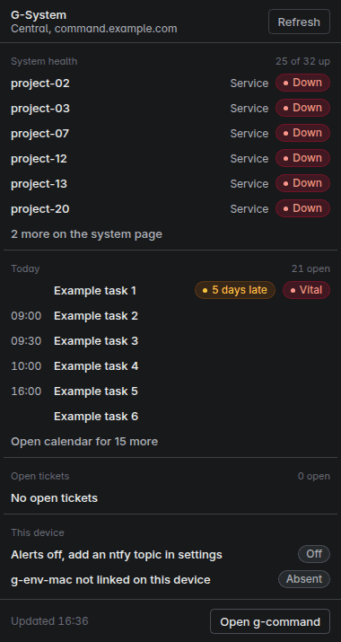 Desktop menu-bar panel, dark | 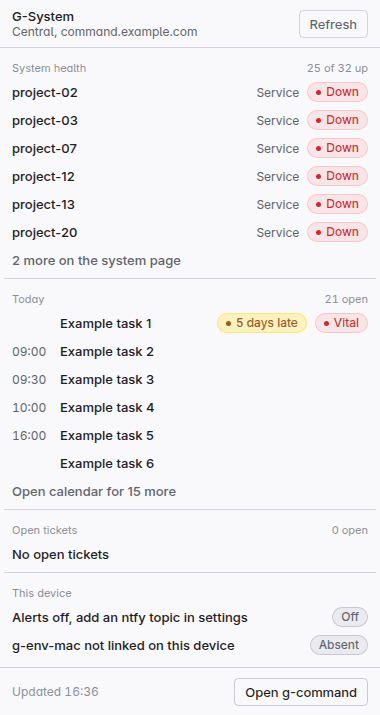 Desktop menu-bar panel, light |

## Still moving

I'm splitting the framework from my own instance in October 2026, and a few pieces haven't landed yet. In g-brain, g-spine and g-pulse are packages already, and g-todos and g-voice follow. There is macOS support for the agent environment too, and I'm still cutting it out of my own Mac setup.

## Licence

Every `g-` repo is open source under the GNU Affero General Public License v3.0, and so is this one. You can use, change and share it, commercially too, as long as you share your changes under the same licence. That covers running a changed copy as a web service, whose users get the source. See [LICENSE](LICENSE).
